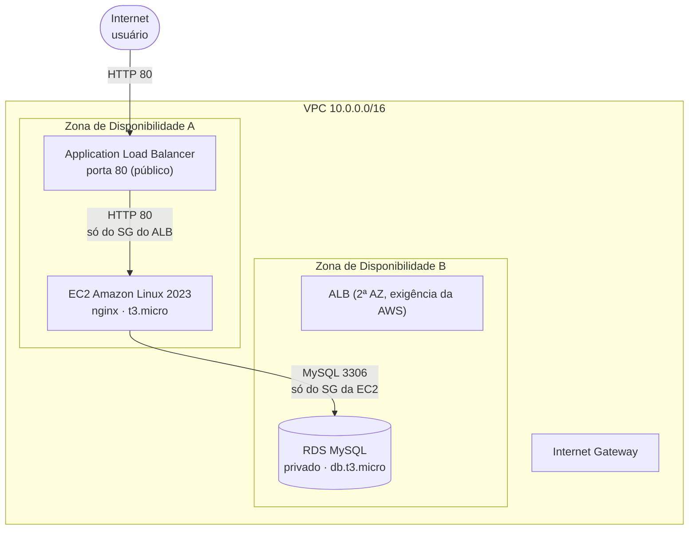

# Atividade III — Infraestrutura AWS com CloudFormation

**Autor:** Christian Sperb · Atividade da disciplina *Desenvolvimento de Software e Operações de TI — DevOps*, Unidade III.

**Base conceitual:** material da disciplina, Unidade III — Infraestrutura como código (cap. 1, p. 3–7), introdução e anatomia de modelos AWS CloudFormation (cap. 2, p. 8–10), modificação de modelos e scripts auxiliares `cfn-init`/`cfn-signal` (cap. 3, p. 32–37).

**Entrega:** um único arquivo [`template.yaml`](template.yaml) que cria, em uma pilha do CloudFormation, uma VPC, uma instância EC2 com nginx, um Application Load Balancer e um banco Amazon RDS MySQL.

---

## 1. O que este projeto cria

Uma pilha do CloudFormation (uma "stack") cria todos os recursos abaixo juntos, na ordem correta, e permite apagar tudo com um único comando.



> O ALB aparece nas duas AZs porque a AWS exige no mínimo duas sub-redes em Zonas de Disponibilidade diferentes. A instância EC2 fica em uma delas; o RDS pode ser colocado em qualquer uma das duas.

| Recurso | O que é | Configuração escolhida |
| --- | --- | --- |
| VPC | Rede isolada na AWS | `10.0.0.0/16`, DNS habilitado |
| Sub-redes | Faixas menores dentro da VPC | 2 públicas (`10.0.0.0/24`, `10.0.1.0/24`), AZs distintas |
| Internet Gateway | Porta de saída da VPC para a internet | 1, anexado à VPC |
| Security Groups | Firewalls por recurso | ALB → EC2 → RDS, encadeados por referência |
| EC2 | Servidor virtual | Amazon Linux 2023, `t3.micro`, nginx instalado no primeiro boot |
| ALB | Distribuidor de tráfego HTTP | internet-facing, listener 80, health check em `/health.html` |
| RDS | Banco de dados gerenciado | MySQL, `db.t3.micro`, privado, senha no Secrets Manager |
| IAM | Permissões | Role com `AmazonSSMManagedInstanceCore` para acesso via SSM |

**Custo aproximado (região `us-east-1`, preços públicos):** EC2 `t3.micro` e RDS `db.t3.micro` cabem no Free Tier nos primeiros 12 meses; o **Application Load Balancer não tem Free Tier** e custa cerca de **US$ 16–20 por mês**. Apague a pilha ao terminar (seção 9).

---

## 2. Pré-requisitos

Para executar você precisa de:

1. **Conta AWS** ativa (a de estudante serve).
2. **Permissão** para criar VPC, EC2, ELB, RDS, IAM e Secrets Manager. O usuário `AdministratorAccess` funciona; em conta de estudante geralmente já é o caso.
3. **AWS CLI v2** (opcional — o caminho pelo console não precisa dela). Instalação: <https://docs.aws.amazon.com/cli/latest/userguide/getting-started-install.html>.
4. **Região escolhida.** Todos os exemplos usam `us-east-1` (Virgínia do Norte), a mais barata e com mais serviços. Para usar outra, troque o valor de `--region` e no canto superior direito do console.
5. **Um par de credenciais** (Access Key) se for usar a CLI:

```bash
aws configure
# AWS Access Key ID:     <sua chave>
# AWS Secret Access Key: <seu segredo>
# Default region name:   us-east-1
# Default output format: json
```

> **Atenção:** este template cria recursos que **custam dinheiro** enquanto existirem. Não deixe a pilha ligada sem necessidade.

---

## 3. Caminho A — Deploy pelo console da AWS (recomendado para quem nunca usou IaC)

1. Abra <https://console.aws.amazon.com/cloudformation> e confirme a região no canto superior direito (`N. Virginia / us-east-1`).
2. Clique em **Create stack** → **With new resources (standard)**.
3. Em **Prerequisite – Prepare template**, marque **Template is ready**.
4. Em **Specify template**, escolha **Upload a template file**, clique em **Choose file** e selecione o `template.yaml` deste diretório. Clique em **Next**.
5. Em **Stack name**, digite um nome, por exemplo `devops-iii-dev`. Esse nome aparece nos recursos e é o que você usará para apagar tudo depois.
6. Preencha os parâmetros (todos têm valor padrão, pode deixar como está):

   | Parâmetro | Padrão | Para que serve |
   | --- | --- | --- |
   | `ProjectName` | `devops-iii` | Prefixo do nome dos recursos |
   | `Environment` | `dev` | `dev` = barato; `prod` = Multi-AZ e proteção contra exclusão |
   | `DBName` | `appdb` | Nome do banco criado no MySQL |
   | `DBUsername` | `dbadmin` | Usuário master (a senha é gerada pela AWS) |
   | `AllowedHttpCidr` | `0.0.0.0/0` | Quem pode acessar o site (restrinja ao seu IP em produção) |

7. Clique em **Next** duas vezes. Em **Capabilities**, marque a caixa **"I acknowledge that AWS CloudFormation might create IAM resources with custom names"**. Sem isso a AWS recusa a criação (o template cria uma *role* IAM).
8. Clique em **Submit**. A tela de eventos mostra o progresso. **O banco RDS leva de 8 a 15 minutos**; o total fica em torno de 12–20 minutos.
9. Quando o status virar **CREATE_COMPLETE**, abra a aba **Outputs**. O valor de `WebsiteUrl` é o endereço para abrir no navegador.

---

## 4. Caminho B — Deploy pela linha de comando (AWS CLI)

Dentro deste diretório:

```bash
# 1) (Opcional) valide o template antes de gastar tempo criando recursos.
aws cloudformation validate-template --template-body file://template.yaml

# 2) Crie a pilha. O nome "devops-iii-dev" é livre; use o mesmo depois para apagar.
aws cloudformation create-stack \
  --stack-name devops-iii-dev \
  --template-body file://template.yaml \
  --parameters ParameterKey=Environment,ParameterValue=dev \
  --capabilities CAPABILITY_IAM \
  --region us-east-1

# 3) Acompanhe a criação (Ctrl+C sai do acompanhamento, não cancela a pilha).
aws cloudformation describe-stack-events \
  --stack-name devops-iii-dev \
  --region us-east-1 \
  --query 'StackEvents[0:15].[Timestamp,ResourceStatus,LogicalResourceId]' \
  --output table

# 4) Espere terminar e veja as saídas (URL do site, endpoint do banco...).
aws cloudformation wait stack-create-complete \
  --stack-name devops-iii-dev --region us-east-1

aws cloudformation describe-stacks \
  --stack-name devops-iii-dev --region us-east-1 \
  --query 'Stacks[0].Outputs' --output table
```

Para mudar parâmetros, acrescente outros `ParameterKey=...`:

```bash
  --parameters \
      ParameterKey=ProjectName,ParameterValue=devops-iii \
      ParameterKey=Environment,ParameterValue=dev \
      ParameterKey=AllowedHttpCidr,ParameterValue=203.0.113.10/32
```

> `--capabilities CAPABILITY_IAM` é obrigatório porque o template cria uma *role* IAM. É a mesma confirmação da caixa marcada no console (passo 7 do caminho A).

---

## 5. Como testar (prova de que funcionou)

### 5.1 O site responde pelo Load Balancer

```bash
# Copie o valor de WebsiteUrl da aba Outputs (ou deste comando):
aws cloudformation describe-stacks --stack-name devops-iii-dev --region us-east-1 \
  --query 'Stacks[0].Outputs[?OutputKey==`WebsiteUrl`].OutputValue' --output text

# Teste com curl (troque pela URL retornada):
curl -i http://devops-iii-dev-1234567890.us-east-1.elb.amazonaws.com
```

Esperado: `HTTP/1.1 200 OK` e o HTML com o título "Infraestrutura provisionada com CloudFormation" e o nome da instância que respondeu.

No console: **EC2 → Load Balancers → Target groups → Targets** deve mostrar a instância como `healthy`. Se estiver `unhealthy`, veja a seção 10.

### 5.2 A instância EC2 está no ar (sem abrir SSH)

```bash
# O ID da instância está no Output "InstanceId".
aws ssm start-session --target <INSTANCE_ID> --region us-east-1
```

Dentro da sessão:

```bash
sudo systemctl status nginx
curl -s localhost/health.html      # deve responder: ok
```

### 5.3 O banco está acessível a partir da EC2 (e só dela)

Na mesma sessão SSM:

```bash
# Instala o cliente MySQL.
sudo dnf install -y mariadb105

# Pega usuário e senha do Secrets Manager (o nome do segredo está no Output
# "DatabaseSecretArn").
SECRET_ARN=$(aws cloudformation describe-stacks --stack-name devops-iii-dev \
  --region us-east-1 \
  --query 'Stacks[0].Outputs[?OutputKey==`DatabaseSecretArn`].OutputValue' --output text)

aws secretsmanager get-secret-value --secret-id "$SECRET_ARN" --region us-east-1 \
  --query SecretString --output text
# Retorna algo como {"username":"dbadmin","password":"..."}

# Conecte usando o endpoint do Output "DatabaseEndpoint" (formato host:porta).
mysql -h <HOST_DO_ENDPOINT> -P 3306 -u dbadmin -p
```

Esperado: o prompt do MySQL aparece. Rode `SHOW DATABASES;` e confirme que `appdb` existe.

De fora da VPC, a conexão **não** funciona — é o comportamento desejado (`PubliclyAccessible: false`).

---

## 6. Mapa do README para o template

Cada linha da tabela aponta o bloco do `template.yaml` (números de linha do arquivo atual) e explica, em linguagem simples, o que ele faz.

| Bloco | Linha | O que faz |
| --- | --- | --- |
| `AWSTemplateFormatVersion` / `Description` | 22–35 | Identifica o template e descreve a pilha no console |
| `Parameters` | 37–90 | Perguntas feitas no deploy (nome do projeto, ambiente, banco, faixa de IP liberada) |
| `ProjectName` | 41 | Prefixo dos nomes, evita conflito entre pilhas |
| `Environment` | 53 | `dev` ou `prod`; controla tamanho das máquinas e proteções |
| `DBName` / `DBUsername` | 62–82 | Nome do banco e usuário master (senha não fica no arquivo) |
| `AllowedHttpCidr` | 83 | Quem pode acessar o site pela internet |
| `Mappings` → `EnvironmentSizing` | 96–110 | Tabela estática: `dev` usa `t3.micro`, `prod` usa `t3.small` |
| `Conditions` → `IsProd` | 112–117 | Liga Multi-AZ, backup de 7 dias e proteção contra exclusão só em `prod` |
| `VPC` | 133 | Cria a rede `10.0.0.0/16` com DNS habilitado |
| `InternetGateway` + `Attachment` | 148–163 | Conecta a VPC à internet |
| `PublicSubnet1` / `PublicSubnet2` | 166–190 | Duas sub-redes em AZs diferentes (exigência do ALB) |
| `RouteTable` + `DefaultRoute` | 192–210 | Manda o tráfego externo para o Internet Gateway |
| `*RouteTableAssociation` | 212–226 | Liga cada sub-rede à tabela de rotas |
| `AlbSecurityGroup` | 232 | Libera a porta 80 para o mundo (ou para o CIDR informado) |
| `InstanceSecurityGroup` | 256 | Libera a porta 80 **só** para o Security Group do ALB |
| `DatabaseSecurityGroup` | 281 | Libera a 3306 **só** para o Security Group da EC2 |
| `InstanceRole` / `InstanceProfile` | 304–332 | Permissão IAM que permite abrir terminal via SSM (sem SSH) |
| `WebServer` → `Metadata` | 339–382 | Lista o que o `cfn-init` instala: nginx, `index.html`, `health.html` |
| `WebServer` → `CreationPolicy` | 384–389 | Só considera a EC2 pronta após o sinal do `cfn-signal` |
| `WebServer` → `ImageId` | 392 | AMI Amazon Linux 2023 mais recente, lida de um parâmetro público da AWS |
| `WebServer` → `UserData` | 403–429 | Script do primeiro boot: instala `aws-cfn-bootstrap`, roda `cfn-init`, sinaliza |
| `LoadBalancer` | 432 | Cria o ALB público nas duas sub-redes |
| `TargetGroup` | 452 | Define destino (a EC2), porta 80 e health check em `/health.html` |
| `HttpListener` | 484 | Recebe na porta 80 e encaminha para o target group |
| `DatabaseSubnetGroup` | 500 | Diz em quais sub-redes o RDS pode ficar |
| `Database` | 512 | Cria o MySQL privado, com senha gerenciada pelo Secrets Manager |
| `Outputs` | 559–594 | Valores exibidos no fim: URL, ID da EC2, endpoint do banco, ARN do segredo |

### Como as dependências são garantidas

O CloudFormation não cria recursos na ordem em que estão escritos no arquivo: ele monta um grafo a partir das referências. Neste template:

| Referência | Efeito |
| --- | --- |
| `VpcId: !Ref VPC` em sub-redes e Security Groups | Sub-redes e grupos só são criados depois da VPC |
| `DependsOn: InternetGatewayAttachment` na rota padrão | A rota espera o gateway estar anexado |
| `SourceSecurityGroupId: !Ref AlbSecurityGroup` | O firewall da EC2 só pode ser criado depois do firewall do ALB |
| `Targets: - Id: !Ref WebServer` | O target group espera a EC2 existir |
| `LoadBalancerArn: !Ref LoadBalancer` no listener | O listener espera o ALB |
| `CreationPolicy` + `cfn-signal` | A pilha espera o nginx subir dentro da EC2 |

---

## 7. Decisões de projeto e justificativas

### 7.1 Por que CloudFormation e não Terraform

O material da Unidade III é dedicado ao **AWS CloudFormation**: anatomia do template (p. 8–10), conjuntos de alterações (p. 32–33), detecção de desvio (p. 34–35) e scripts auxiliares `cfn-init`/`cfn-signal` (p. 36–37). Usar CloudFormation mantém a entrega alinhada ao conteúdo estudado e permite aplicar, na prática, os conceitos de **Parameters**, **Mappings**, **Conditions**, **Outputs** e **dependências implícitas** descritos no PDF. Terraform exigiria estudar uma ferramenta que o material não cobre.

### 7.2 Por que nginx instalado no primeiro boot (e não uma AMI pronta de terceiros)

O template usa a **AMI oficial Amazon Linux 2023** e instala o nginx com `cfn-init`. Motivos:

- **Confiabilidade:** a AMI vem da própria AWS, sem depender de imagens de marketplace de terceiros (que podem ter custo adicional, versões desatualizadas ou software desconhecido).
- **Rastreabilidade:** o que é instalado está escrito no template, versionado no Git — é exatamente o princípio de IaC do material (p. 4–7: "codificar o que queremos").
- **Didática:** usar `cfn-init` (metadados) + `cfn-signal` (`CreationPolicy`) demonstra o mecanismo de sincronização ensinado no cap. 3 (p. 36–37): a pilha só é dada como criada quando o servidor web está de fato no ar.
- **Custo:** nenhuma AMI de marketplace com taxa horária.

### 7.3 Por que a AMI vem de um parâmetro SSM e não de um ID fixo

`{{resolve:ssm:/aws/service/ami-amazon-linux-latest/al2023-ami-kernel-default-x86_64}}` resolve, em tempo de deploy, o ID da AMI mais recente da Amazon Linux 2023 **na região em uso**. Um ID fixo (`ami-0abc...`) só existe em uma região e envelhece (a AWS despublica AMIs antigas), fazendo o template falhar meses depois.

### 7.4 Por que duas sub-redes em Zonas de Disponibilidade diferentes

O Application Load Balancer **exige** no mínimo duas sub-redes em AZs distintas; com uma só, o deploy falha com erro de validação. Além de obrigatório, é o que permite ao ALB continuar atendendo se uma AZ ficar indisponível.

### 7.5 Por que os Security Groups se referenciam em vez de usar faixas de IP

O grupo da EC2 aceita tráfego **apenas** do grupo do ALB, e o grupo do RDS **apenas** do grupo da EC2 (`SourceSecurityGroupId`). Vantagens:

- A EC2 não fica exposta diretamente na internet.
- O banco não é alcançável de fora da VPC (`PubliclyAccessible: false`).
- Se o ALB for recriado com outro IP, nada precisa ser reconfigurado: a referência é ao grupo, não ao endereço.

### 7.6 Por que a senha do banco não está no template

`ManageMasterUserPassword: true` faz a AWS gerar a senha e guardá-la no **AWS Secrets Manager**. Nenhuma senha aparece no `template.yaml`, no histórico do Git ou nos eventos da pilha. O `Outputs` entrega o ARN do segredo, e a seção 5.3 mostra como lê-lo.

### 7.7 Por que SSM Session Manager em vez de SSH

Abrir a porta 22 e distribuir pares de chaves é uma superfície de ataque desnecessária. Com a *role* `AmazonSSMManagedInstanceCore`, o acesso ao terminal passa pelo serviço SSM, autenticado pelo IAM e auditável no CloudTrail, sem nenhuma porta de administração exposta. Custo: uma *role* e um *instance profile* no template.

### 7.8 Por que não há NAT Gateway, Auto Scaling nem HTTPS

- **NAT Gateway** custaria ~US$ 32/mês e não é necessário: a instância fica em sub-rede pública.
- **Auto Scaling** não é pedido na atividade e adicionaria um Launch Template e um grupo — mais peças para o mesmo resultado demonstrável.
- **HTTPS** exigiria um certificado no ACM e um domínio validado; fica como evolução (basta adicionar um listener 443 e um `AWS::CertificateManager::Certificate`).

---

## 8. Referências externas ao material e por que foram usadas

O material da disciplina é a referência principal. As consultas abaixo foram pontuais, para detalhes de sintaxe ou requisitos atuais do serviço:

| Referência | Por que foi necessária |
| --- | --- |
| [Template anatomy](https://docs.aws.amazon.com/AWSCloudFormation/latest/UserGuide/template-anatomy.html) | O PDF (p. 9) cita esta página como continuação da anatomia; usei para confirmar a ordem e a obrigatoriedade das seções. |
| [Parâmetros públicos do SSM para AMIs](https://docs.aws.amazon.com/AWSEC2/latest/UserGuide/finding-an-ami.html) | O material não trata de AMIs dinâmicas; sem isso o template precisaria de um ID fixo, que quebra em outra região. |
| [Requisitos do Application Load Balancer](https://docs.aws.amazon.com/elasticloadbalancing/latest/application/application-load-balancers.html) | Confirmar a exigência de **duas sub-redes em AZs diferentes** — requisito do serviço, não do material. |
| [Helper scripts reference](https://docs.aws.amazon.com/AWSCloudFormation/latest/UserGuide/cfn-helper-scripts-reference.html) | O PDF descreve `cfn-init`/`cfn-signal` (p. 36–37); a página foi usada para confirmar o caminho `/opt/aws/bin/` e a instalação do pacote `aws-cfn-bootstrap` no Amazon Linux 2023. |
| [RDS — senha gerenciada](https://docs.aws.amazon.com/AmazonRDS/latest/UserGuide/rds-secrets-manager.html) | Recurso posterior ao material; permite não colocar senha no template. |
| [SSM Session Manager](https://docs.aws.amazon.com/systems-manager/latest/userguide/session-manager.html) | Alternativa segura ao SSH, não coberta na unidade. |

Nenhuma biblioteca, template de terceiros ou código copiado foi usado: o `template.yaml` foi escrito para esta atividade.

---

## 9. Como apagar tudo (evitar cobrança)

### Pelo console

1. **CloudFormation → Stacks →** selecione a pilha → **Delete**.
2. Confirme. A exclusão leva ~10 minutos (o RDS é o mais lento).

### Pela CLI

```bash
aws cloudformation delete-stack --stack-name devops-iii-dev --region us-east-1

# Acompanhe até sumir:
aws cloudformation wait stack-delete-complete \
  --stack-name devops-iii-dev --region us-east-1
```

### Depois de apagar, confira

| Item | Onde verificar | Ação se sobrou |
| --- | --- | --- |
| Snapshots de RDS | RDS → Snapshots | Apagar manualmente (o template usa `DeletionPolicy` padrão, então não deveria sobrar nenhum) |
| Segredo do Secrets Manager | Secrets Manager → Secrets | O segredo do RDS é removido junto com o banco; se aparecer um `rds!db-...` órfão, apague |
| Load Balancer | EC2 → Load Balancers | Não deve sobrar nenhum com o nome da pilha |
| Elastic IP | EC2 → Elastic IPs | O template não cria EIP; nada a fazer |

> Se a pilha ficou em `DELETE_FAILED`, quase sempre é o **RDS com `DeletionProtection: true`** (só acontece com `Environment=prod`). Desative a proteção no console do RDS e apague de novo.

---

## 10. Problemas comuns (troubleshooting)

| Sintoma | Causa provável | Solução |
| --- | --- | --- |
| `Requires capabilities : [CAPABILITY_IAM]` | Falta autorizar a criação da *role* IAM | Console: marque a caixa em **Capabilities**. CLI: `--capabilities CAPABILITY_IAM` |
| Status `ROLLBACK_COMPLETE` | Algum recurso falhou; a pilha não pode ser atualizada nesse estado | Veja o primeiro evento com `CREATE_FAILED` na aba **Events**, corrija e **delete** a pilha antes de criar outra |
| Target group com destino `unhealthy` | nginx não subiu ou `/health.html` não existe | Abra sessão SSM e rode `sudo systemctl status nginx` e `ls /usr/share/nginx/html` |
| `CREATE_FAILED` na EC2 com "did not receive the expected number of signals" | `cfn-init` falhou dentro da instância (ex.: sem saída para internet) | Veja o log em `/var/log/cloud-init-output.log` via SSM |
| `DBInstance ... cannot be created` / cota | Limite de instâncias RDS na conta | Apague bancos antigos ou peça aumento de cota |
| Erro de AMI não encontrada | Região sem o parâmetro SSM da AL2023 | Troque a região ou informe um `ImageId` válido daquela região |
| `sed: can't read .../index.html` | `cfn-init` não criou o arquivo | Confirme que o bloco `Metadata` não foi editado |
| Site abre mas mostra página padrão do nginx | `index.html` não foi sobrescrito | Rode o `cfn-init` novamente: `sudo /opt/aws/bin/cfn-init -v --stack <stack> --resource WebServer --region <região>` |
| Pilha demora mais de 20 min | RDS em criação + `CreationPolicy` de 10 min da EC2 | Normal no primeiro deploy; acompanhe pelos eventos |

Logs úteis dentro da instância (via SSM):

```bash
sudo tail -100 /var/log/cloud-init-output.log   # saída do UserData/cfn-init
sudo tail -50  /var/log/nginx/error.log         # erros do nginx
```

---

## 11. Estrutura do projeto

```
atividade-iii-cloudformation/
├── template.yaml    # toda a infraestrutura, comentada linha a linha
└── README.md        # este arquivo
```

---

## 12. Checklist de entrega

- [x] Instância EC2 criada (`WebServer`, Amazon Linux 2023, `t3.micro`)
- [x] Load Balancer criado (`LoadBalancer`, Application, internet-facing)
- [x] Banco de dados criado (`Database`, RDS MySQL, privado)
- [x] Load Balancer encaminha para a EC2 (`TargetGroup` + `HttpListener`)
- [x] EC2, ALB e RDS na mesma VPC, com comunicação liberada por Security Groups
- [x] Referências e dependências explícitas (`Ref`, `GetAtt`, `DependsOn`, `CreationPolicy`)
- [x] Security Groups, sub-redes, Internet Gateway e rotas incluídos
- [x] README com passo a passo para quem nunca usou AWS
- [x] Comentários explicando cada bloco do template
- [x] Sem Redshift
- [x] Referências externas justificadas (seção 8)
