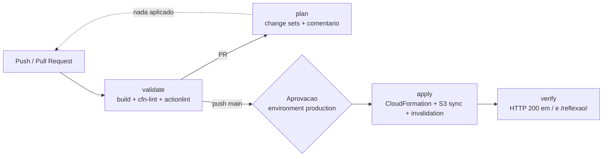

# Atividade IV — Pipeline CI/CD com GitHub Actions e AWS

**Autor:** Christian Sperb · Disciplina *Desenvolvimento de Software e Operações de TI — DevOps*, Unidade IV.

**Entrega:** pipeline em `.github/workflows/deploy.yml` que valida, planeja e aplica a infraestrutura da Atividade III (CloudFormation) na AWS e publica a SPA deste repositório em Amazon S3 + CloudFront.

---

## 1. O que o pipeline faz



| Gatilho | O que acontece |
| --- | --- |
| `pull_request` para `main` | `validate` + `plan`. Cria change sets, publica o resumo no PR e **não aplica nada** |
| `push` em `main` | `validate` → `apply` (com aprovação do environment `production`) → `verify` |
| `workflow_dispatch` (`action=apply`) | Mesmo fluxo do push, útil para reprocessar sem commit |
| `workflow_dispatch` (`action=destroy`) | Esvazia o bucket da SPA e apaga as duas stacks |

Duas stacks são gerenciadas:

| Stack | Template | Conteúdo |
| --- | --- | --- |
| `devops-iv-spa` | `atividade-iv-cicd/cloudformation/spa-hosting.yaml` | S3 privado + CloudFront + OAC + CloudFront Function |
| `devops-iii-dev` | `atividade-iii-cloudformation/template.yaml` | VPC, 4 sub-redes (2 públicas + 2 privadas), EC2 com nginx, ALB e RDS MySQL em sub-redes privadas (Atividade III) |

---

## 2. Matriz requisito → implementação

| Requisito do enunciado | Onde está |
| --- | --- |
| 1. Versionar no GitHub | Repositório `chrissperb/4P-Devops`, branch `main` |
| 2. Workflow que faz deploy da IaC da Atividade III | `.github/workflows/deploy.yml`, job `deploy` → `cfn-change-set.sh` |
| 3a. Autenticação AWS | `configure-aws-credentials` + Secrets `AWS_ACCESS_KEY_ID`, `AWS_SECRET_ACCESS_KEY`, `AWS_ROLE_ARN`, `AWS_ROLE_EXTERNAL_ID` |
| 3b. Acionado por push ou PR na branch principal | Bloco `on:` (`push` e `pull_request` em `main`) |
| 3c. init/plan/apply equivalentes | `validate-template` (init/validação), `create-change-set` + `describe-change-set` (plan), `execute-change-set` (apply) |
| 3d. Artifacts e state | `upload-artifact`; planos, build e relatórios em `s3://$ARTIFACTS_BUCKET/runs/<run_id>/`. O state da infraestrutura é gerenciado pelo próprio CloudFormation (não existe arquivo de state local como no Terraform) |
| 4. Logs do build e deploy | Logs de cada step, tabela de mudanças, `$GITHUB_STEP_SUMMARY` e comentário no PR |
| Documentar no README | Este arquivo + seção de deploy no `README.md` raiz |
| Expor a SPA externamente | CloudFront com HTTPS, bucket privado, `/` e `/reflexao/` |

---

## 3. Por que não OIDC

O enunciado aceita OIDC **ou** `AWS_ACCESS_KEY_ID`/`AWS_SECRET_ACCESS_KEY`. Nesta conta, OIDC é tecnicamente impossível:

```
$ aws iam simulate-principal-policy --action-names iam:CreateOpenIDConnectProvider ...
iam:CreateOpenIDConnectProvider   explicitDeny   AllowedByOrganizations=false
```

O SCP do plano FREE do novo AWS experience contém `iam:*Provider*` em `DenyIAMRestrictedActions`; a conta tem `Providers: 0`. Criar o provedor OIDC do GitHub é negado antes de qualquer tentativa.

Solução adotada, com o mesmo objetivo de menor privilégio:

1. Usuário IAM `github-actions-4p-devops` **sem login no console** e com política que permite **apenas** `sts:AssumeRole` na role de deploy.
2. Role `gha-4p-devops-deploy` com política escopada (CloudFormation nas stacks do projeto, S3 dos buckets do projeto, CloudFront, serviços da stack da Atividade III).
3. `sts:ExternalId` no trust, para impedir confusão de papel por terceiros.
4. O runner recebe credenciais **temporárias** do STS (máximo 1 hora).

O único segredo de longa duração é a access key, restrita a assumir uma role. Rotacione a cada 90 dias com `scripts/rotate-key.sh`.

---

## 4. Estrutura

```
atividade-iv-cicd/
├── cloudformation/
│   └── spa-hosting.yaml          # S3 + CloudFront + OAC + Function
├── iam/
│   ├── github-user-policy.json    # apenas sts:AssumeRole
│   ├── deploy-role-trust.json     # trust + ExternalId
│   └── deploy-role-policy.json    # permissões escopadas
├── params/
│   ├── spa-dev.json
│   └── dev-atividade-iii.json
├── s3/
│   └── artifacts-lifecycle.json   # expiração de artifacts
├── scripts/
│   ├── bootstrap-aws.sh           # cria usuário, role, policies e bucket
│   ├── cfn-change-set.sh          # plan/apply genérico
│   ├── empty-bucket.sh            # remove versões antes do delete
│   └── rotate-key.sh              # rotação da access key
└── README.md
```

---

## 5. Pré-requisitos

- Conta AWS **686420703845**, região **us-east-2** (região única do projeto).
- AWS CLI v2 autenticada (`aws login` ou profile do VS Code).
- Node.js 20 e npm.
- Acesso de administrador local para o bootstrap (a role `AccountFullAccessRole` do projeto serve).

Confirme a região e a conta:

```bash
export AWS_PROFILE=chrissperb
export AWS_REGION=us-east-2

aws sts get-caller-identity     # Account 686420703845
aws configure set region us-east-2 --profile chrissperb
```

> A conta aplica um SCP de região: apenas `us-east-2` (a região do projeto) é aceita para serviços regionais. Não troque a região.

---

## 6. Passo 1 — Bootstrap da conta

```bash
cd atividade-iv-cicd
chmod +x scripts/*.sh
AWS_PROFILE=chrissperb ./scripts/bootstrap-aws.sh
```

O script é idempotente e cria:

| Recurso | Nome |
| --- | --- |
| Bucket de artifacts | `devops-iv-artifacts-686420703845-us-east-2` |
| Usuário IAM | `github-actions-4p-devops` |
| Política inline do usuário | `GitHubActionsAssumeOnly` |
| Role | `gha-4p-devops-deploy` |
| Política gerenciada da role | `gha-4p-devops-deploy-policy` |

Ao final ele imprime os valores para os Secrets e grava `atividade-iv-cicd/.bootstrap.env` (modo `600`, ignorado pelo Git). O `ExternalId` fica apenas nesse arquivo e no GitHub Secrets.

---

## 7. Passo 2 — Configurar o GitHub

Em **Settings → Secrets and variables → Actions**:

| Secret | Origem |
| --- | --- |
| `AWS_ACCESS_KEY_ID` | saída do bootstrap |
| `AWS_SECRET_ACCESS_KEY` | saída do bootstrap |
| `AWS_ROLE_ARN` | saída do bootstrap |
| `AWS_ROLE_EXTERNAL_ID` | saída do bootstrap |
| `ARTIFACTS_BUCKET` | saída do bootstrap |

Em **Settings → Environments**, crie `production` e adicione **Required reviewers** (você). É o portão de aprovação manual descrito no material (continuous delivery).

Em **Settings → Branches**, proteja `main` exigindo pull request e o check do job `validate` (`Validar build e templates`).

> Pull requests vindos de forks não recebem secrets. O job `plan` roda apenas em branches do próprio repositório.

---

## 8. Passo 3 — Usar o pipeline

### Pull request (plano)

```bash
git switch -c feature/minha-mudanca
# edite os arquivos
git push -u origin feature/minha-mudanca
```

O workflow roda `validate` e `plan`, comenta a tabela de mudanças no PR e não altera a AWS.

### Merge na main (aplicação)

Após o merge, o job `deploy` aguarda a aprovação do environment `production` e então:

1. aplica a stack `devops-iv-spa`;
2. sincroniza `dist/` para o bucket (assets com cache imutável, HTML com cache curto);
3. invalida `/*` no CloudFront;
4. aplica a stack `devops-iii-dev`;
5. `verify` confirma `200` em `/` e `/reflexao/` e o redirecionamento HTTP → HTTPS.

A URL pública aparece no resumo da execução e no output `WebsiteUrl` da stack.

### Rodar manualmente

**Actions → Deploy AWS (CloudFormation + SPA) → Run workflow**:

| Entrada | Uso |
| --- | --- |
| `action=apply` | Reaplicar sem novo commit |
| `action=apply`, `skip_infra=true` | Atualizar só a SPA (não mexe em VPC/EC2/RDS) |
| `action=destroy` | Apagar as stacks e parar a cobrança |
| `action=destroy`, `skip_infra=true` | Apagar só a stack da SPA |

---

## 9. Reproduzir do zero

```bash
# 1. Clonar e instalar
git clone https://github.com/chrissperb/4P-Devops.git
cd 4P-Devops
npm ci

# 2. Confirmar build local na raiz
npm run build:ci
npm run preview          # http://localhost:4173/
                         # http://localhost:4173/reflexao/

# 3. Bootstrap da AWS (uma vez)
cd atividade-iv-cicd
AWS_PROFILE=chrissperb ./scripts/bootstrap-aws.sh

# 4. Configurar os 5 secrets e o environment production no GitHub

# 5. Abrir um PR de teste e, depois, fazer merge na main
```

Sem o GitHub Actions, os mesmos passos podem ser executados à mão.

### Equivalente manual

```bash
export AWS_PROFILE=chrissperb AWS_REGION=us-east-2
REPO=/caminho/para/4P-Devops

# "init" + validacao
aws cloudformation validate-template \
  --template-body "file://$REPO/atividade-iv-cicd/cloudformation/spa-hosting.yaml"

# "plan"
aws cloudformation create-change-set \
  --stack-name devops-iv-spa \
  --change-set-name manual-plan \
  --change-set-type CREATE \
  --template-body "file://$REPO/atividade-iv-cicd/cloudformation/spa-hosting.yaml" \
  --parameters "file://$REPO/atividade-iv-cicd/params/spa-dev.json"

aws cloudformation describe-change-set \
  --stack-name devops-iv-spa --change-set-name manual-plan \
  --query 'Changes[].ResourceChange.[Action,LogicalResourceId,ResourceType]' \
  --output table

# "apply"
aws cloudformation execute-change-set \
  --stack-name devops-iv-spa --change-set-name manual-plan
aws cloudformation wait stack-create-complete --stack-name devops-iv-spa

# publicar a SPA
cd "$REPO"
BUCKET="$(aws cloudformation describe-stacks --stack-name devops-iv-spa \
  --query "Stacks[0].Outputs[?OutputKey=='BucketName'].OutputValue" --output text)"
DIST_ID="$(aws cloudformation describe-stacks --stack-name devops-iv-spa \
  --query "Stacks[0].Outputs[?OutputKey=='DistributionId'].OutputValue" --output text)"

aws s3 sync dist/assets "s3://$BUCKET/assets" \
  --cache-control "public,max-age=31536000,immutable"
aws s3 sync dist "s3://$BUCKET" --delete --exclude "assets/*" \
  --cache-control "public,max-age=300,must-revalidate"
aws cloudfront create-invalidation --distribution-id "$DIST_ID" --paths "/*"

# stack da Atividade III
aws cloudformation validate-template \
  --template-body "file://$REPO/atividade-iii-cloudformation/template.yaml"
aws cloudformation deploy \
  --stack-name devops-iii-dev \
  --template-file "$REPO/atividade-iii-cloudformation/template.yaml" \
  --parameter-overrides \
    ProjectName=devops-iii \
    Environment=dev \
    DBName=appdb \
    DBUsername=dbadmin \
    AllowedHttpCidr=0.0.0.0/0 \
  --capabilities CAPABILITY_IAM
```

> `create-change-set` com `--change-set-type UPDATE` quando a stack já existir.

---

## 10. Matriz boas práticas (Unidade IV) → implementação

| Prática do material | Implementação |
| --- | --- |
| CI: build e teste a cada commit (p. 3–5) | Job `validate` em todo push e PR |
| `main` sempre implantável (p. 6–7) | PR só gera plano; merge aplica o que passou no `validate` |
| Continuous delivery com aprovação humana (p. 6–10) | Environment `production` com required reviewer |
| Trunk-based e pull requests revisados (p. 29–31) | PR obrigatório + branch protection + check `validate` |
| Menor privilégio e credenciais temporárias (p. 21–23) | Usuário só `AssumeRole` + ExternalId + credenciais STS de 1 h |
| Artefatos em S3 criptografados e com ciclo de vida (p. 53, 69–70) | Bucket versionado, SSE-KMS, lifecycle de 30 dias |
| Configuração externalizada (antipadrão, p. 59) | `params/*.json` e GitHub Secrets; nada hardcoded no script |
| Cache de dependências (p. 69–70) | `actions/setup-node` com `cache: npm` |
| Estágios ordenados e nomes únicos (p. 50–51) | `validate → plan → aprovação → apply → verify` |
| Logs e monitoramento (p. 62–64) | Logs por step, tabela de mudanças, resumo e eventos do CloudFormation |
| Blue-green/canary/rolling (p. 11–13) | Assets com hash e invalidação atômica no CloudFront; mudanças de infra via change set revisado |
| Segurança de build e permissões (p. 78–79) | Role escopada por recurso; secrets fora do repositório |

---

## 11. Custos

| Recurso | Custo aproximado (us-east-2) |
| --- | --- |
| CloudFront + S3 da SPA | centavos por mês no tráfego deste projeto |
| ALB da stack da Atividade III | ~US$ 16–20/mês (sem Free Tier) |
| RDS `db.t3.micro` | ~US$ 13–15/mês (fora do Free Tier após 12 meses) |
| EC2 `t3.micro` | baixo custo / Free Tier |
| Artifacts no S3 | centavos; expiram em 30 dias |

A conta tem US$ 140 em créditos. Configure um spend limit em **AWS Settings → Billing** e rode `action=destroy` ao terminar a demonstração.

---

## 12. Segurança

- Nenhuma credencial no repositório; o `.bootstrap.env` é ignorado pelo Git.
- Access key restrita a `sts:AssumeRole` com `ExternalId`.
- Role de deploy escopada por stack, bucket e prefixo de role.
- Bucket da SPA privado, com bloqueio público total e leitura apenas pelo CloudFront (OAC).
- Artefatos e bucket da SPA com criptografia em repouso; o bucket da SPA usa SSE-S3 para que o CloudFront (OAC) leia sem grant adicional no KMS, e o bucket de artifacts usa SSE-KMS.
- Logs do pipeline não imprimem secrets.
- Rotação: `./scripts/rotate-key.sh` cria a nova chave; atualize os secrets e remova a antiga com `--delete <ID>`.

---

## 13. Troubleshooting

| Sintoma | Causa | Solução |
| --- | --- | --- |
| `NoRegion` | profile sem região | `aws configure set region us-east-2 --profile chrissperb` |
| `explicit deny ... service control policy` em região | SCP RegionFloor | Use `us-east-2`; o workflow já fixa |
| `iam:CreateOpenIDConnectProvider` negado | SCP `iam:*Provider*` | Use access keys (caminho adotado) |
| `didn't contain changes` | Nada mudou | Tratado como sucesso (`unchanged`) |
| Stack em `ROLLBACK_COMPLETE` | Criação anterior falhou | `action=destroy` e reaplique |
| CloudFront 403 após deploy | Objeto ausente ou OAC | Confira o `s3 sync`, o `BucketName` e a invalidação |
| `AccessDenied` no apply | Permissão faltando na role | Ajuste `iam/deploy-role-policy.json` e rode o bootstrap |
| `InvalidClientTokenId` / chave expirada | Access key rotacionada/removida | Gere nova com `rotate-key.sh` e atualize os secrets |
| Job `plan` sem secrets em PR | PR de fork | Rode o plano em branch do próprio repositório |
| RDS demora > 20 min | Criação inicial | Normal; o job tem 75 min de timeout |
| Change set da stack III mostra `Replacement` no RDS | Migração do DB subnet group para sub-redes privadas | Em stack com dados, faça snapshot manual e revise o change set antes de aprovar; em `dev` sem dados, recriar é aceitável |
| Cota de RDS/EC2 | Limite da conta | Apague recursos antigos ou peça aumento |

Logs úteis:

```bash
aws cloudformation describe-stack-events --stack-name devops-iii-dev \
  --max-items 30 \
  --query 'StackEvents[].[Timestamp,LogicalResourceId,ResourceStatus,ResourceStatusReason]' \
  --output table
```

---

## 14. Limitações conhecidas

- **Sem domínio próprio**: a URL é o domínio `*.cloudfront.net`. Um domínio exigiria ACM + Route 53, indisponíveis/desnecessários para a atividade.
- **Sem OIDC**: bloqueado pelo SCP da conta (seção 3).
- **Região única**: `us-east-2`, imposta pelo novo AWS experience.
- **Ambiente único**: `dev`. O material recomenda contas separadas para dev/staging/prod; a plataforma oferece um único project/account. A separação é feita por nome de stack e parâmetros.
