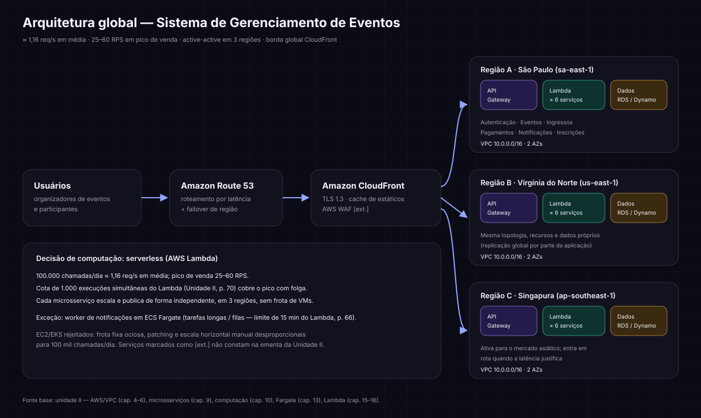
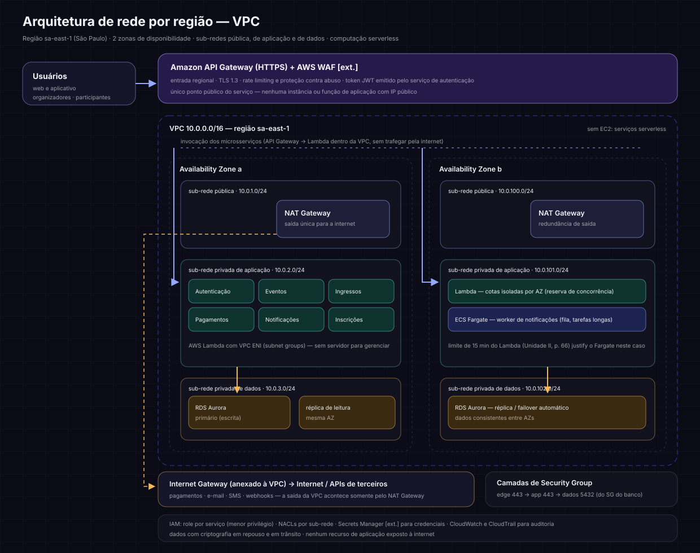

# Estudo de caso — Sistema de Gerenciamento de Eventos

**Autor:** Christian Sperb · Atividade da disciplina *Desenvolvimento de Software e Operações de TI — DevOps*, Unidade II.
**Base conceitual:** unidade II do material da disciplina (AWS e segurança, VPC, segurança de tráfego, IAM, microsserviços, serviços de computação, ECS/Fargate, Lambda e suas cotas).

---

## 1. Contexto do negócio

| Item | Descrição |
| --- | --- |
| Sistema | Plataforma de gerenciamento de eventos (criação de eventos, venda de ingressos, inscrição de participantes, pagamento e comunicação) |
| Personas | Organizadores de eventos e participantes |
| Volume | ~100.000 chamadas de API por dia |
| Abrangência | Inicialmente local (Brasil), com potencial de operação mundial |
| Microsserviços | Autenticação · Gerenciamento de Eventos · Gerenciamento de Ingressos · Pagamentos · Notificações · Inscrições |

## 2. Dimensionamento da carga

| Métrica | Valor | Observação |
| --- | --- | --- |
| Média | 1,16 req/s | 100.000 ÷ 86.400 s |
| Pico de venda | 25–60 RPS | Concentração na abertura de vendas (fator 20–50× sobre a média) |
| Execuções simultâneas necessárias | < 60 | Uma requisição por usuário ativo em paralelo |
| Cota de execuções simultâneas do Lambda | 1.000 | Unidade II, p. 70 — folga de ~16× sobre o pico |
| Vazão por invocação | 6 MB (síncrono) | Unidade II, p. 70 — folgado para payloads de evento/ingresso |
| Duração máxima | 15 min | Unidade II, p. 66 — define o limite de uso do Lambda |

Duas conclusions estruturam a decisão: **(a)** a carga é baixa em termos absolutos e **(b)** é concentrada em janelas curtas. Isso favorece execução sob demanda, com escala automática, em vez de frota fixa de máquinas.

## 3. Decisão de computação: serverless (AWS Lambda) como padrão

| Critério | Lambda (serverless) | VMs (EC2/EKS) |
| --- | --- | --- |
| Escala no pico de venda | automática, em segundos | provisionamento prévio + Auto Scaling |
| Custo com 1,16 req/s médio | cobrado por requisição (~0) | custo fixo de instâncias ociosas |
| Operação | sem patch, sem SO, sem orquestração | patching, AMI, clusters, monitoring |
| Publicação independente | por função, com versionamento próprio | por imagem e pipeline de deployment |
| Operação mundial | mesma imagem em qualquer região | duplicação de capacidade por região |
| Limite de execução | 15 min | ilimitado |

**Escolha:** os seis microsserviços rodam como funções Lambda (uma ou mais funções por serviço, Publish/Alias para versionamento), com exceção do **worker de notificações**, que roda em **ECS Fargate** por processar filas e tarefas longas — acima do limite de 15 min do Lambda (Unidade II, p. 66). VMs (EC2/EKS) foram descartadas: para 100 mil chamadas/dia, a frota fixa fica ociosa a maior parte do dia e introduz custo e complexidade de operação sem retorno.

## 4. Desenho da arquitetura

### 4.1 Visão global (multi-região)

- **Route 53** resolve o usuário para a região de menor latência e permite *failover* de região.
- **CloudFront** (rede global de borda, cap. 1) termina TLS, serve estáticos em cache e aplica WAF; a API dinâmica segue para o API Gateway regional.
- **Três regiões ativas** (São Paulo, Virgínia do Norte, Singapura), com a mesma topologia, publish de API por região e dados próprios — a rota para a Ásia pode ser ativada depois, sem redesenhar a arquitetura.
- Cada região recebe o tráfego pela borda global; a falha de uma região não interrompe as demais.

### 4.2 Arquitetura de rede por região (VPC)

**Segmentação da VPC (2 AZs, CIDR 10.0.0.0/16):**

| Sub-rede | CIDR | Tipo | Conteúdo |
| --- | --- | --- | --- |
| pública | 10.0.1.0/24 · 10.0.100.0/24 | pública (rota para IGW) | NAT Gateway (um por AZ) para saída das integrações |
| de aplicação | 10.0.2.0/24 · 10.0.101.0/24 | privada | ENIs das funções Lambda; tasks do Fargate |
| de dados | 10.0.3.0/24 · 10.0.102.0/24 | privada | RDS Aurora primário + réplica de leitura; failover entre AZs |

**Controle de tráfego e acesso:**

- **Security Groups em camadas**: `edge` (443 do exterior) → `app` (443 apenas do SG da borda) → `dados` (5432 apenas do SG da aplicação). Nenhuma função ou task de aplicação possui IP público; a entrada pública é exclusivamente o API Gateway.
- **NACLs** nas sub-redes, complementando os SGs com bloqueio de origem não autorizada e rate limiting na borda.
- **IAM com role por serviço** (menor privilégio): o serviço de pagamentos recebe permissão só sobre o provedor de pagamento e sobre a tabela de transações; o serviço de autenticação só sobre o diretório de usuários.
- **NAT Gateway único por AZ** para saída (pagamentos, e-mail, SMS), com Internet Gateway anexado à VPC; sem rota direta das sub-redes privadas para a internet.
- **Secrets Manager** e criptografia em repouso e em trânsito para credenciais de terceiros e dados pessoais.

### 4.3 Microsserviços

| Serviço | Responsabilidade | Estado/recursos |
| --- | --- | --- |
| Autenticação | cadastro, login, emissão de token (JWT) | Cognito ou tabela `usuários`; tokens verificados nos demais serviços |
| Gerenciamento de Eventos | cadastro, edição, status e agenda dos eventos | tabela `eventos`; dono do dado mestre |
| Gerenciamento de Ingressos | lotes, tipos, preços e bloqueios de venda | tabela `ingressos` + `lotes`; controle de concorrência na venda |
| Pagamentos | autorização, capture, estorno e conciliação | tabela `transacoes`; integração com o provedor (saída via NAT) |
| Notificações | e-mail/SMS/push e fila de disparo | fila SQS [ext.] + worker Fargate |
| Inscrições | vínculo participante↔evento, check-in, cancelamento | tabela `inscricoes`; consome eventos de `eventos` e `ingressos` |

Comunicação: **síncrona** entre o front-end e a API (API Gateway → Lambda); **assíncrona** entre serviços (fila para notificações, eventos de domínio para propagação de mudanças). O microsserviço de eventos é o dono do dado mestre; os demais o consultam por API ou por réplica de leitura, evitando acoplamento direto ao banco.

## 5. Justificativa (2 parágrafos)

O desenho adotado é **serverless, com AWS Lambda como padrão dos seis microsserviços**, apoiado por uma VPC por região organizada em sub-redes públicas, de aplicação e de dados, distribuídas em duas zonas de disponibilidade. A justificativa nasce do volume: 100.000 chamadas por dia equivalem a cerca de 1,16 requisição por segundo, e o pico de venda (25–60 RPS) fica muito abaixo da cota de 1.000 execuções simultâneas do Lambda (Unidade II, p. 70), de modo que a plataforma absorve o pico automaticamente, sem provisionamento antecipado, pagando apenas pelo uso. Em termos de rede, o isolamento em sub-redes privadas com Security Groups em camadas (edge → aplicação → dados), NAT Gateway para a única saída controlada e IAM com role por serviço garante que nenhum componente de aplicação fique exposto, ao mesmo tempo em que a distribuição entre AZs mantém a operação disponível em caso de falha de zona — o que é decisivo para um sistema em que a venda de ingressos tem janelas de altíssima concentração.

A abrangência potencial motivou a decisão de **não amarrar a solução a uma única região**: Route 53 com roteamento por latência, CloudFront como borda global e topologia idêntica em três regiões (São Paulo, Virgínia do Norte e Singapura) fazem o sistema nascer local e atingir escala mundial sem redesenho, bastando replicar a VPC e publicar as funções na nova região. A exceção ao Lambda é deliberada e pequena: o worker de notificações roda em ECS Fargate porque processa filas e tarefas longas, acima do limite de 15 minutos de execução do Lambda (Unidade II, p. 66); VMs (EC2/EKS) foram descartadas porque, nesse volume, a frota fixa permaneceria ociosa na maior parte do tempo, somando custo e complexidade operacional sem qualquer ganho de escala. Em conjunto, a arquitetura equilibra custo de operação, isolamento de rede e preparo para a expansão global, mantendo a entrega contínua de cada microsserviço de forma independente.

## 6. Referências da unidade II

| Tema | Capítulos / páginas |
| --- | --- |
| Infraestrutura global, CloudFront | cap. 1, p. 3–6 |
| VPC, sub-redes, IGW, NAT, tabelas de rota | cap. 4, p. 11–18 |
| Segurança de tráfego (Security Groups, NACLs) | cap. 5, p. 19–24 |
| Gerenciamento de acesso (IAM), autenticação e autorização | cap. 6–8, p. 25–34 |
| Visão geral de microsserviços | cap. 9, p. 35–39 |
| Serviços de computação (EC2) | cap. 10, p. 40–49 |
| ECS e Fargate (rede integrada à VPC) | cap. 13, p. 55–59 |
| AWS Lambda | cap. 15, p. 63–69 |
| Lambda: cotas e práticas recomendadas | cap. 16, p. 70–71 |

> **Serviços marcados como [ext.]** (API Gateway, AWS WAF, SQS, Secrets Manager, RDS Aurora) não constam na ementa da Unidade II, mas são complementação necessária para um desenho operacional de mercado; todo o restante usa exclusivamente o conteúdo do material da disciplina.
